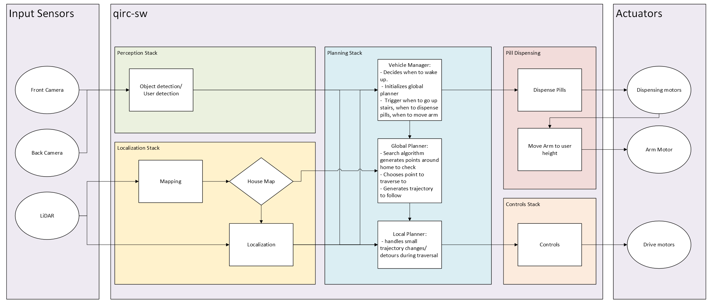

# Queen's Intelligent Robotic Companion (QIRC)

**MREN 403: Capstone**

**Authors:** Lukas Hendry, Pablo Silva, Liam McIntaggart, Vikram Lew

---

## Overview

The QIRC is an autonomous mobile robot that stores, dispenses, and delivers pill medication to the user within the home. It can navigate between floors, including going upstairs, and has a friendly, non-threatening design so it is comfortable to have around.

## Hardware

| Component | Purpose |
|---|---|
| Intel RealSense D435i (front) | Depth/RGB camera for object, person, and stairwell detection; its built-in IMU is used for odometry |
| OAK-D Lite (rear) | Second depth/RGB camera; runs person detection on the camera itself |
| RPLIDAR A2M8 | 360° 2D LiDAR for mapping and localization |
| NVIDIA Jetson Orin Nano | Onboard compute |

<!-- TODO: add drivetrain, stair-climbing mechanism, pill dispenser, and battery details. -->

## Software Architecture



The QIRC runs on **ROS 2 (Humble)**. Functionality is split into packages, each containing nodes that communicate over ROS 2 topics, services, and actions.

| Package | Responsibility |
|---|---|
| `qirc_perception` | Detect objects, people, and stairwells from camera input |
| `qirc_localization` | Build a map and estimate the robot's pose |
| `qirc_planning` | Decide where the robot goes and how it gets there |
| `qirc_control` | Turn planned paths into vehicle commands |
| `qirc_pill_dispenser` | Dispense pills and operate the delivery arm |
| `qirc_bringup` | Launch files that start the whole robot |
| `qirc_description` | Robot model (URDF) |
| `qirc_interfaces` | Custom ROS 2 messages, services, and actions |

All packages live in `src/`. The nodes and the topics between them are documented in [docs/architecture](docs/architecture/).

---

## Repository Structure

### Perception Package

Uses camera input from the RealSense D435i and the OAK-D Lite to detect objects, persons, and stairwells.

- **Camera drivers**: The manufacturers' ROS 2 drivers (`realsense2_camera`, `depthai_ros_driver`) stream the images, depth, and IMU data.
- **Object Detection Node**: Runs detection on the camera streams and publishes detections for the rest of the system.

### Localization Package

Uses the RPLIDAR A2M8 (through Slamtec's `rplidar_ros` driver) to build a map of the home and determine where the robot is within it.

- **Mapping Node**: Builds the map using SLAM (`slam_toolbox`). No prior map of the home is assumed, so the robot maps the space on first deployment.
- **Localization Node**: Loads the saved map and estimates the robot's pose within it (`slam_toolbox` localization mode).

### Planning Package

Decides where the vehicle goes and how it gets there.

- **Vehicle Manager Node**: Top-level coordinator that sequences tasks and manages the state of the whole system.
- **Global Planner Node**: Plans a route to the goal using A*.
- **Local Planner Node**: Follows the global route while avoiding obstacles in real time.

### Control Package

Controls the vehicle's motion.

- **Control Node**: Tracks the planned path using a model predictive control (MPC) algorithm.

### Pill Dispenser Package

Handles medication storage and delivery.

- **Pill Box Node**: Controls how many pills are dispensed.
- **Arm Node**: Raises and lowers the arm when appropriate to present the medication to the user.

---

## Getting Started

Requires Ubuntu 22.04 with [ROS 2 Humble](https://docs.ros.org/en/humble/Installation.html) installed.

```bash
# Clone the repository
git clone https://github.com/LukasHendry1/qirc.git
cd qirc

# Install dependencies (including the camera and LiDAR drivers)
source /opt/ros/humble/setup.bash
rosdep install --from-paths src --ignore-src -y

# Build
colcon build --symlink-install
source install/setup.bash

# Launch the robot (each sensor can be turned off, e.g. use_lidar:=false)
ros2 launch qirc_bringup qirc.launch.py
```

## Documentation

- [Roadmap](docs/ROADMAP.md): project phases and tasks
- [Architecture](docs/architecture/): ROS 2 node graph, node list, and message definitions
- [Wiring](docs/wiring/): power distribution diagram

## License

<!-- TODO: add license. -->