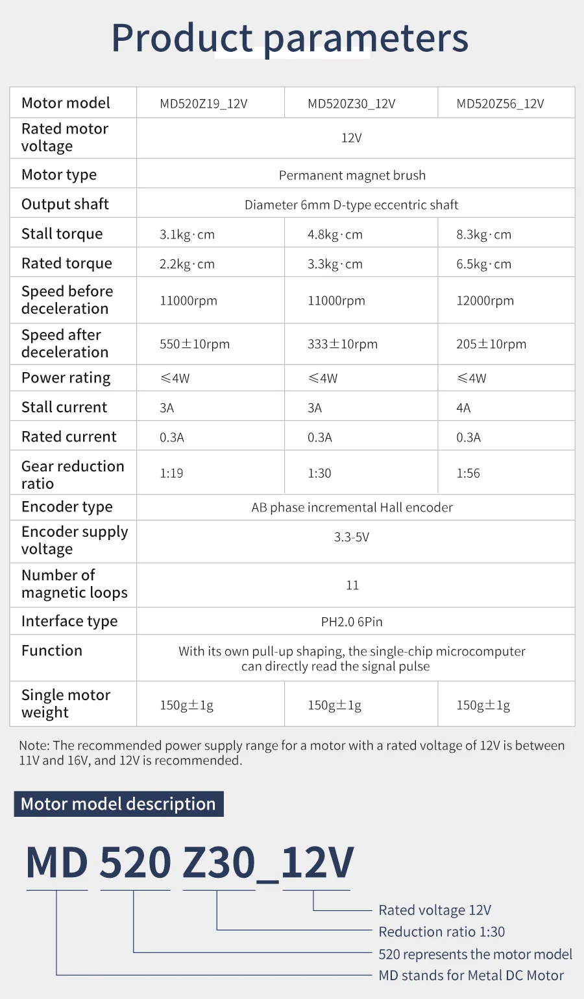
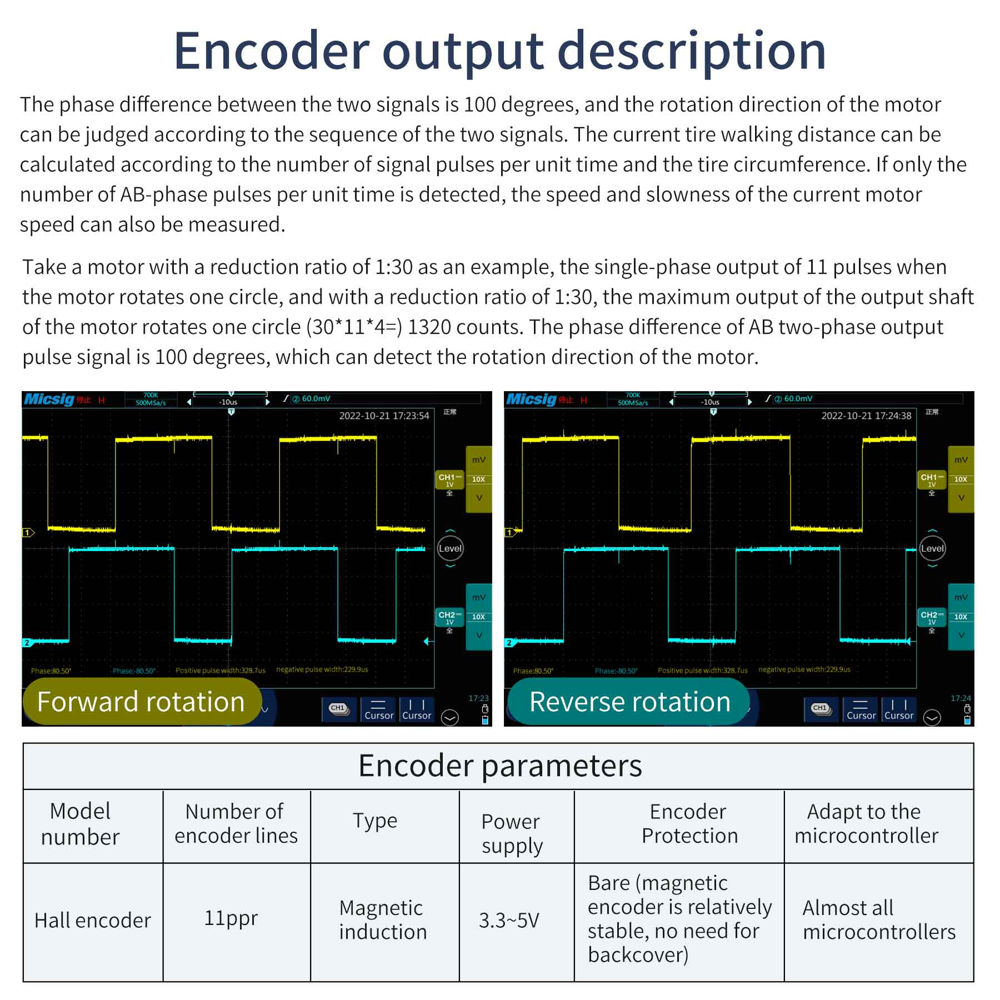
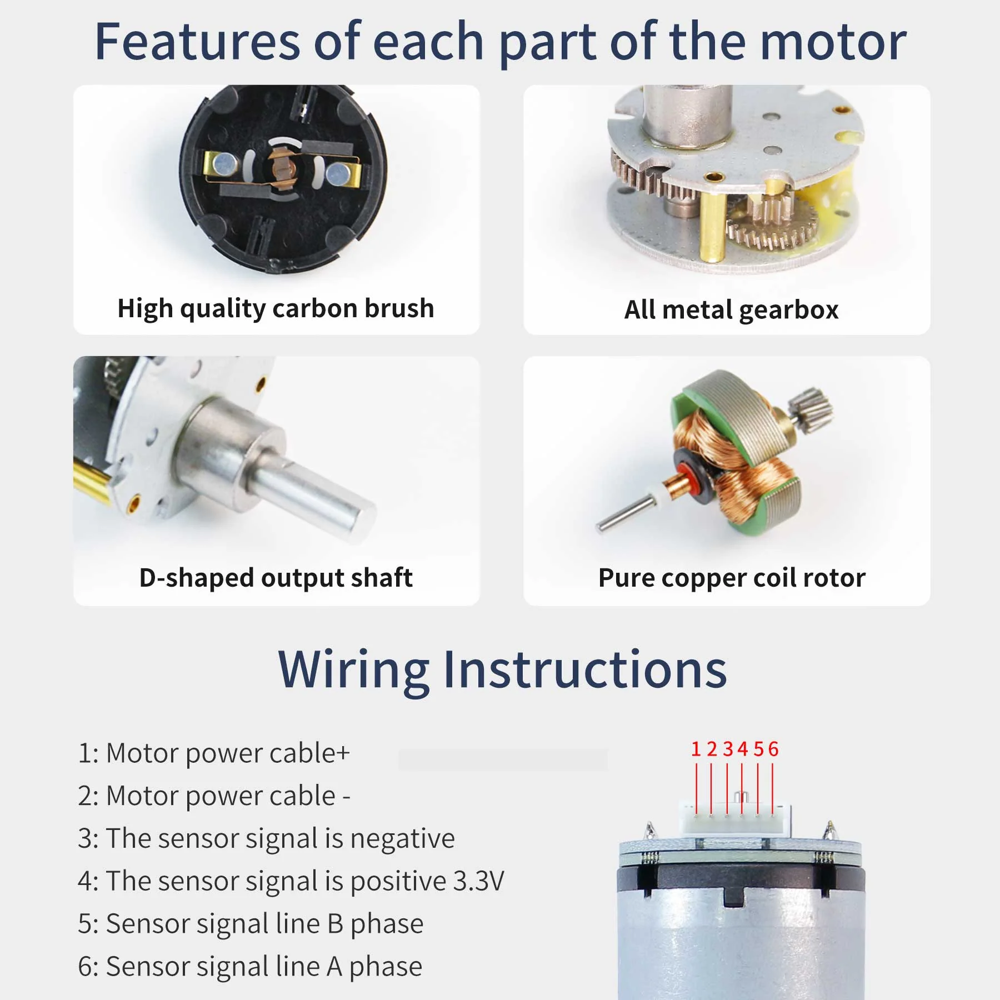

# Yahboom 520 DC gear motor with encoder (MD520)

**Used for:** the arm motors (×2).

**Product:** Yahboom's "520 DC Gear Motor with Encoder 205RPM 333RPM 550RPM", SKU 6000301311, US$7.90 each (separate motor). Yahboom doesn't publish a downloadable datasheet. This sheet is compiled from the product page and its spec images, which are saved in [images/](images/), and from Yahboom's tutorial pages. The sources are listed at the end.

**Model code:** MD520Z30_12V means
- **MD:** metal DC motor
- **520:** motor size
- **Z30:** 1:30 reduction
- **12V:** rated voltage

**Variants:** three, which differ only in their gearbox. The RPM number on the label identifies the variant.

| Variant | Gear ratio | Output speed |
|---|---|---|
| MD520Z19_12V | 1:19 | 550 rpm |
| MD520Z30_12V | 1:30 | 333 rpm |
| MD520Z56_12V | 1:56 | 205 rpm |

**Versions:** each variant is sold either as a separate motor or with a mounting bracket.

> **TODO:** record which variant the arm uses: ______

## Electrical

| Parameter | MD520Z19 | MD520Z30 | MD520Z56 |
|---|---|---|---|
| Motor type | Permanent-magnet brushed DC (carbon brushes, copper-wound rotor) | ← | ← |
| Rated voltage | 12 V | 12 V | 12 V |
| Recommended supply | 11–16 V (12 V recommended) | ← | ← |
| Rated current | 0.3 A | 0.3 A | 0.3 A |
| Stall current | 3 A | 3 A | 4 A |
| Rated power | ≤ 4 W (3.6 W in the comparison table) | ← | ← |
| Stall power at 12 V *(derived: 12 V × stall current)* | 36 W | 36 W | 48 W |

12 V × 0.3 A = 3.6 W, which matches the rated power in the comparison table.

## Mechanical

| Parameter | MD520Z19 | MD520Z30 | MD520Z56 |
|---|---|---|---|
| Gearbox | All-metal spur gears | ← | ← |
| Reduction ratio | 1:19 | 1:30 | 1:56 |
| Motor speed (before gearbox) | 11000 rpm | 11000 rpm | 12000 rpm |
| Output speed (after gearbox)¹ | 550 ± 10 rpm | 333 ± 10 rpm | 205 ± 10 rpm |
| Rated torque | 2.2 kg·cm (0.216 N·m) | 3.3 kg·cm (0.324 N·m) | 6.5 kg·cm (0.638 N·m) |
| Stall torque | 3.1 kg·cm (0.304 N·m) | 4.8 kg·cm (0.471 N·m) | 8.3 kg·cm (0.814 N·m) |
| Output shaft | 6 mm D-shaft, offset from the motor axis | ← | ← |
| Weight | 150 ± 1 g | 150 ± 1 g | 150 ± 1 g |
| Mounting width (pair, wheel to wheel)² | 76 mm | ← | ← |

¹ The output speed is the motor speed divided by the gear ratio (for example 11000 / 30 ≈ 367 rpm), so this is most likely the **no-load** speed, not the speed under rated load.

² From Yahboom's comparison table ("Motor installation width 76 mm", "chassis width greater than 15 cm"). This is for their car chassis, not a dimension of the motor itself.

N·m values are converted at 1 kg·cm = 0.0981 N·m.

## Encoder

| Parameter | Value |
|---|---|
| Type | Incremental Hall (magnetic) encoder, A/B outputs |
| Lines | 11 pulses per motor revolution, per phase (11 ppr) |
| A/B phase difference | ~100° (measured by Yahboom), not an ideal 90° |
| Supply voltage | 3.3–5 V |
| Output | Square wave, with a built-in pull-up and signal shaping, so a microcontroller pin can read it directly |
| Protection | Bare: no back cover over the encoder board |
| Counts per motor revolution (×4 quadrature) | 44 |
| Counts per output revolution (44 × gear ratio) | Z19: 836; Z30: 1320 (Yahboom's worked example); Z56: 2464 |

**Direction:** the direction of rotation is given by which phase leads.

**Edge timing:** because the phase difference is 100° rather than 90°, the four edges per cycle are not evenly spaced. That doesn't affect counting, only a speed estimate taken from the time between single edges.

**Using it with the Pico:** supply the encoder from **3.3 V**. The pull-ups bring the outputs to the encoder's supply voltage, and the Pico's RP2040 pins aren't 5 V tolerant.

## Connector and pinout

PH2.0, 6 pins. One connector carries both the motor and the encoder.

| Pin | Signal | Connect to |
|---|---|---|
| 1 | Motor power + | Motor driver output A |
| 2 | Motor power − | Motor driver output B |
| 3 | Encoder GND | Pico GND |
| 4 | Encoder VCC (3.3 V) | Pico 3V3 |
| 5 | Encoder phase B | Pico GPIO |
| 6 | Encoder phase A | Pico GPIO |

**Phase naming:** Yahboom's tutorial notes that the motor's A output goes to the B input of Yahboom's own driver boards. Phase naming isn't consistent, so check the count direction in software rather than relying on the labels.

## Not published

Yahboom doesn't publish these. Measure them if they're needed:
- no-load current
- overall dimensions, and the size and spacing of the mounting holes
- shaft length
- gearbox backlash

A 3D model may be in Yahboom's "Model File" download, linked from the tutorial page.

## Discrepancies in Yahboom's material

- **Rated torque in the comparison table:** the comparison table ([images/md520_comparison.png](images/md520_comparison.png)) gives 3.1 / 4.8 / 8.3 kg·cm. Those are the **stall** torques in the main parameter table. This sheet uses the main table.
- **A second copy of the parameter table:** one copy on the product page swaps two values, showing "Encoder supply voltage: 11" and "Number of magnetic loops: 3.3–5V". The copy saved here and the encoder table both give 3.3–5 V and 11 lines.

## Sources

- **Product page:** [yahboom.store/products/md520](https://www.yahboom.store/products/md520). The text and the spec images were provided by hand on 2026-11-23, because the site blocks automated access. The images are saved in [images/](images/).
- [Yahboom tutorial, "Motor introduction and usage"](https://www.yahboom.net/study/MD520/14105)
- [Yahboom tutorial index (downloads)](https://www.yahboom.net/study/MD520)
- [YahboomTechnology/520-DC-Motor on GitHub](https://github.com/YahboomTechnology/520-DC-Motor)

Compiled 2026-11-23.
