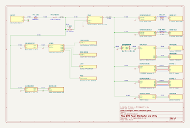

# Power schematic (KiCad)

[`qirc_power.kicad_sch`](qirc_power.kicad_sch) is the power distribution drawn as a KiCad 8 schematic (custom 325 × 220 mm sheet): battery, main fuse and switch, the E-stop and contactor, the converters, and every powered part with its wire gauge. It shows the same design as the WireViz diagram in [`../wiring`](../wiring/) ([power.yml](../wiring/power.yml)), laid out as a circuit.

[PDF](qirc_power.pdf) · [SVG](qirc_power.svg)



- **Top row:** battery → 40 A fuse (F_BAT) → loop key (SW1) → `+BAT_SW`. The contactor K1 switches `+BAT_SW` onto the motor rail `+24V_MOT`. The E-stop (ES1, normally closed) is in series with K1's coil, so pressing it opens K1. D1 is the coil's flyback diode.
- **Cut by the E-stop:** everything on `+24V_MOT`: both drive drivers (each with a 15 A fuse on its motor lead), the 12 V arm rail and arm driver, both dispenser steppers, and the headlights.
- **Always on:** the Jetson (with its USB devices) and the status LEDs, fed from `+BAT_SW`, so the robot can report a stop.

## Editing

The schematic is generated by [`make_schematic.py`](make_schematic.py), which holds the parts, the layout and the intended nets. Edit the script, not the `.kicad_sch` file, then run:

```bash
python3 docs/Electrical/schematic/make_schematic.py
```

It needs KiCad 8 (`kicad-cli`). It writes the schematic and project, exports the PDF and SVG, and checks KiCad's netlist against the intended nets in the script (`NETS`). It fails if any drawn connection differs. Commit the regenerated files together with the script.

The symbols are simple boxes embedded in the schematic, so it opens in KiCad without extra libraries. If you change the design, also update [power.yml](../wiring/power.yml), so the two diagrams agree.
