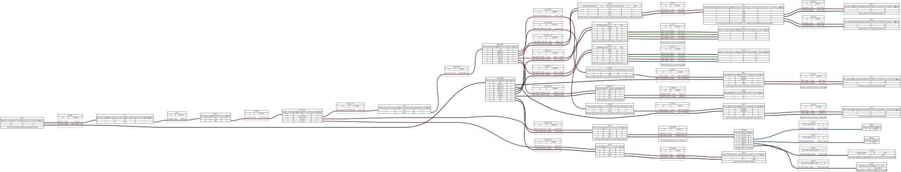

# Wiring diagrams

Wiring diagrams written as [WireViz](https://github.com/wireviz/WireViz) YAML. The `.yml` file is the source; the `.svg`, `.png` and `.bom.tsv` (bill of materials) files are generated from it.

| Diagram | Status |
|---|---|
| [power.yml](power.yml) ([SVG](power.svg)) | Draft: battery, protection, distribution, regulators, motor drivers and USB devices |
| Signals (Pico pin map) | Not started; waits on the Pico pin map |



## Design decisions

- **E-stop cuts the motor rail only.** The Jetson, Pico and LEDs stay powered, so the robot can log the stop and show it on the status LEDs and web app.
- **24 V system:** 8S LiFePO4 battery (25.6 V nominal, 10 Ah) and 24 V drive motors. The DRV8825s and headlights run from the same rail.
- **12 V arm rail:** the arm motors (Yahboom MD520Z19, 12 V) and their TB6612FNG driver (13.5 V max) run from a 12 V buck converter. It's fed from the motor rail after the E-stop, so the E-stop also stops the arm. It's sized at 6 A or more, for both arm motors stalled (2 × 3 A).
- **The Jetson has its own buck-boost converter** with a steady 19 V output, so motor current spikes that dip the battery voltage don't reboot it.
- **Fuses: three in total.**
  - **40 A main fuse** at the battery, sized for both drive motors stalling at once (2 x 21 A) on a battery whose BMS allows 40 A or more.
  - **15 A slow-blow fuse on each drive driver** (MD10C, 13 A continuous, 30 A for 10 s). It passes starts and short peaks but blows on a held stall (21 A).
  - **No other branch fuses.** The converters, steppers, arm and headlights are protected by the main fuse only. Their 18–22 AWG wires are not protected against faults below 40 A, so keep those runs short and well secured.
  - All fuses must be rated **32 V DC or more**, with a **breaking capacity of 1000 A or more** (ATO/MAXI blade or MIDI). Glass 5×20 mm fuses rated for 250 V AC break only about 35 A and must not be used on the battery.
- **All grounds meet at one common ground bus.**
- **USB devices are powered by the Jetson** (cameras, LiDAR, Pico).

## TBD

- **Drive motor encoders:** the E-S Motor 36PG has none. Odometry needs them.
- **Drive current:** motor stall (21 A) is above the MD10C's 13 A continuous rating (30 A peak), so firmware must limit current or detect stalls.
- **30 V margin:** the MD10C is rated to 30 V and a full 8S LiFePO4 is 29.2 V. Don't drive while charging.
- **Arm driver current:** the TB6612FNG is rated 1.0 A per channel continuous, but an arm motor stalls at 3 A. Firmware must cap the PWM duty and cut a channel when its encoder stops while driven ([datasheet](../Datasheets/SparkFun_TB6612FNG_motor_driver.md)).
- Battery not bought yet.

## Editing

```bash
pip install wireviz          # also needs Graphviz: sudo apt install graphviz
wireviz docs/Electrical/wiring/power.yml
```

Commit the regenerated `.svg`, `.png` and `.bom.tsv` together with the `.yml`. Avoid `->`, `<` and `>` in labels; Graphviz rejects them.
