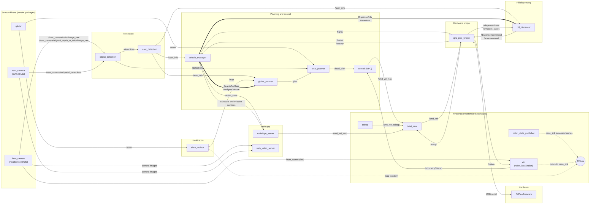

# ROS 2 Node Graph

How the QIRC nodes connect. Details for each node are in [nodes.md](nodes.md) and for each message in [messages.md](messages.md).

**Legend:**
- `-->` topic
- `==>` action (vehicle manager sends a goal, the server reports progress and a result)
- `-.->` TF transform, published to the TF tree. TF is read by every node that needs positions, so those edges are not drawn.

`foxglove_bridge` (development visualization) can see every topic, so it isn't drawn.
