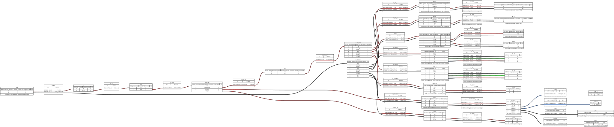

# Wiring diagrams

Wiring diagrams written as [WireViz](https://github.com/wireviz/WireViz) YAML. The `.yml` file is the source; the `.svg`, `.png` and `.bom.tsv` (bill of materials) files are generated from it.

| Diagram | Status |
|---|---|
| [power.yml](power.yml) ([SVG](power.svg)) | Draft: battery, protection, distribution, regulators, motor drivers and USB devices |
| Signals (Pico pin map) | Not started; waits on the Pico pin map |



## Design decisions

- **E-stop cuts the motor rail only.** The Jetson, Pico and LEDs stay powered, so the robot can log the stop and show it on the status LEDs and web app.
- **The Jetson has its own buck-boost converter** with a steady 19 V output, so motor current spikes that dip the battery voltage don't reboot it.
- **All grounds meet at one common ground bus.**
- **USB devices are powered by the Jetson** (cameras, LiDAR, Pico).

## TBD

- Battery: 4S LiFePO4 (12.8 V, 12-15 Ah) is the recommendation, not yet bought.
- Drive motors (assumed 12 V gearmotors with encoders) and their stall current, which set the main fuse rating and the main and drive wire gauges.
- Arm motors' voltage and their driver.
- RPLidar model.

## Editing

```bash
pip install wireviz          # also needs Graphviz: sudo apt install graphviz
wireviz docs/wiring/power.yml
```

Commit the regenerated `.svg`, `.png` and `.bom.tsv` together with the `.yml`. Avoid `->`, `<` and `>` in labels; Graphviz rejects them.
